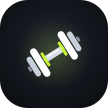
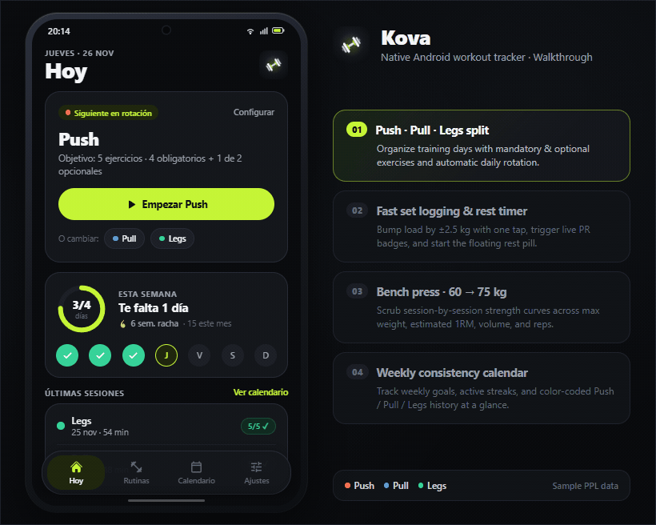

# Kova

A native Android workout tracker built with Kotlin, Jetpack Compose, Material 3, and Room. Kova is designed to log gym sessions quickly and show clear strength progress over time.

## What it does

- **Custom routines:** Organize training days (such as Push, Pull, Legs, or your own split) with required and optional exercises and a daily exercise target.
- **Guided workout logging:** Track sets, reps, and weight (or bodyweight/added load) with your last session shown as reference and quick-adjust controls.
- **Floating rest timer:** Automatically starts a compact rest timer pill after each set, with quick time adjustments and sound/haptic alerts.
- **Progress charts:** View trends for estimated 1RM, max weight, total volume, and reps, with automatic personal record (PR) and plateau detection.
- **Weekly calendar:** See workout streaks and weekly consistency at a glance based on your weekly training goal.
- **Local-first data:** Stores everything offline in SQLite (Room) with full JSON backup and export support.
